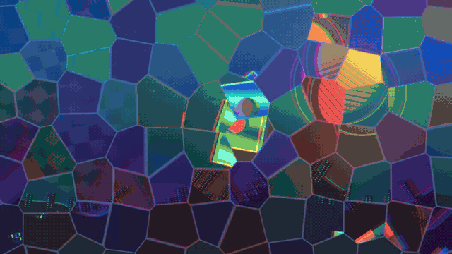
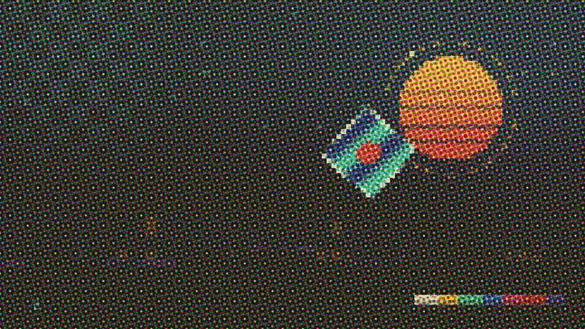
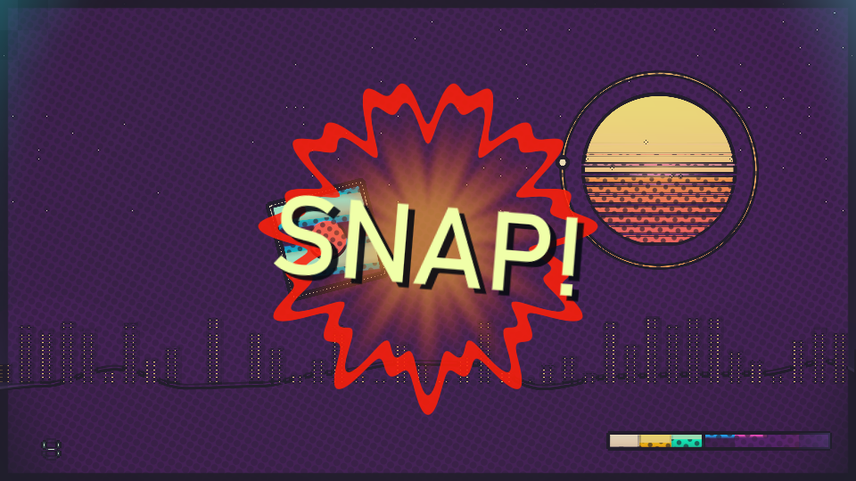
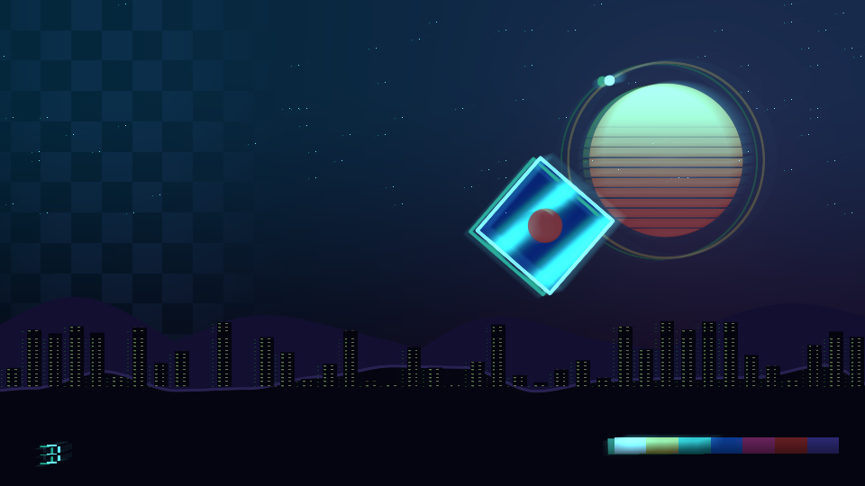
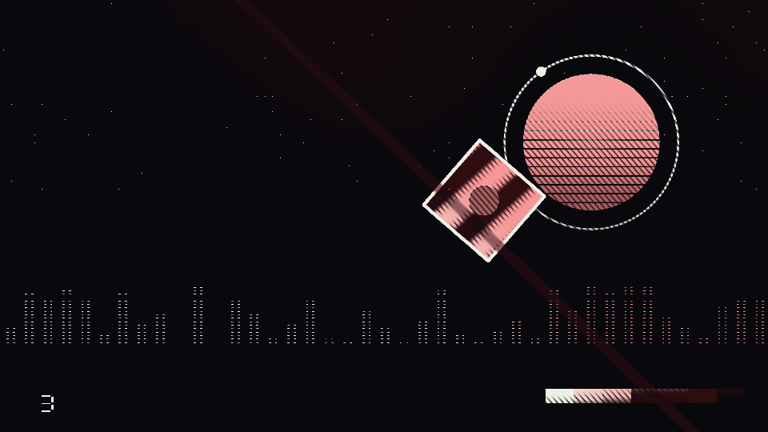

<div align="center">

# SNAP//REALITY

**A local Windows webcam studio with 20 GPU effects. Snap your fingers to switch effects, and broadcast through OBS Virtual Camera.**


</div>

`Physical webcam → MediaPipe snap recognition + Three.js effects → SNAP//REALITY — OBS OUTPUT → OBS Window Capture → OBS Virtual Camera → Discord / Zoom / Google Meet`

---

## 🎬 Demo

The output starts with an animated DEMO scene that needs no camera or files. The clip below is a 12 second excerpt of it cycling through effects and transitions.

<p align="center">
  <br>
  <sub>Looping preview (640px wide, 12 s). Full 72 s, 960x540 recording: <a href="artifacts/SnapReality-Showcase.mp4">artifacts/SnapReality-Showcase.mp4</a> (about 34 MB).</sub>
</p>

Rendered stills from the same DEMO scene:

<p align="center">
  
  <br>
  <sub><b>Left:</b> 04 Halftone Print. <b>Right:</b> a transition frame with comic starburst and SNAP typography.</sub>
</p>

<p align="center">
  
  <br>
  <sub><b>Left:</b> 14 Neon Trails. <b>Right:</b> 20 Graphic Monochrome. More frames are in <a href="artifacts/stage2/">artifacts/stage2</a> and <a href="artifacts/stage6/">artifacts/stage6</a>; the effect list is in the <a href="docs/FX_CATALOG.md">FX catalog</a>.</sub>
</p>

## Features

- 20 GPU effects plus Original pass-through (for example Halftone Print, Cel Shaded, RGB Glitch, Neon Trails, Vortex Portal, Synthwave Grid, Graphic Monochrome). Full list in the [FX catalog](docs/FX_CATALOG.md).
- Finger-snap control: bring thumb and middle finger together in view with **Hand tracking** on, then snap. **Space** in the output window and **Next effect** also advance; **R** returns to Original.
- Visual snap recognition by default, or **Visual + audio** (enable the microphone) to require a nearby audio transient with a recognized release. **Calibrate snaps** shows the accepted count and cooldown.
- Processing modes: **Whole scene**, **Person only**, **Background only**, **Split style** (second effect for the background). Without a live mask the whole scene stays live with the selected effect.
- Ten transition styles with adjustable duration and strength, or off. Effect rotation and presets let you reorder, exclude, or shuffle effects and save rotation and numeric settings locally.
- **Save PNG** and **Record video** of the processed canvas (pause/resume; stops after five minutes or at its memory limit). Recordings are video-only.
- Dedicated **SNAP//REALITY — OBS OUTPUT** window for OBS Window Capture, with an in-app OBS setup panel and generated test pattern.
- Local only: frames and inference stay on the machine; camera acquisition requires **Start camera**.

## Tech stack

| Area | Technology |
| --- | --- |
| App | React 19, TypeScript, Vite |
| Rendering | Three.js shaders (`shaders/`) |
| Vision | MediaPipe Tasks Vision (pinned model via `npm run setup:models`) |
| Desktop | Electron, portable Windows build |
| Testing | Vitest, Playwright, performance benchmarks |
| Legacy | TouchDesigner project (`SnapReality.toe`) and Python gesture service (`gesture_service/`) |

## Quick start

Install Node.js 22.12+ and OBS Studio. In PowerShell, from the repository root:

```powershell
npm ci
npm run setup:models
npm run electron:dev
```

Electron opens the control panel and **SNAP//REALITY — OBS OUTPUT**. The output starts with the animated DEMO. Select a physical webcam and click **Start camera**. Close the control panel while broadcasting, or use **Ctrl+Shift+O** in the output window to reopen it.

<details>
<summary><b>OBS Virtual Camera setup</b></summary>

In OBS create a scene containing one **Window Capture** source aimed at **SNAP//REALITY — OBS OUTPUT**. Disable cursor capture, use client-area capture when available, and set canvas and output to **1280×720 at 30 FPS**. Start OBS Virtual Camera and select **OBS Virtual Camera** in the receiving app. Select your microphone there separately. Follow the [OBS setup and hardware acceptance checklist](docs/OBS_SETUP.md) and [troubleshooting guide](docs/OBS_TROUBLESHOOTING.md).

</details>

<details>
<summary><b>Portable Windows build and browser development</b></summary>

```powershell
npm run setup:models
npm run electron:build
```

Open `SNAP-REALITY.exe` inside the generated `release` directory and keep its adjacent files together. The local build is unsigned. The first setup downloads dependencies and the pinned vision model. The DEMO uses neither a camera nor files.

Browser development:

```powershell
npm run dev
```

Open the localhost address printed by Vite. **Clean OBS output** uses the same canvas and camera as the controls. Press **Esc** to return to controls after stopping OBS capture. Use Electron for a dedicated output window.

</details>

<details>
<summary><b>Verification and status</b></summary>

```powershell
npm run validate
npm run perf:smoke
npm run perf:benchmark
```

Automated checks use installed Google Chrome and a synthetic camera. The performance scripts emit JSON and Markdown in `reports/performance/` and check compatible baselines. Source-frame cadence, render cadence, and trigger-to-draw latency are separate measurements. See the [test commands and benchmark method](docs/WEB_TESTING.md) and [iteration reports](ITERATION_REPORT.md). The [720p per-effect benchmark](reports/performance/final-benchmark.md) records the measured DEMO workload and is backed by the [machine-readable baseline](reports/performance/baseline-full.json).

Physical webcam, real snap recognition, OBS Window Capture, OBS Virtual Camera, and video-call output are **NOT VERIFIED**. The Windows build uses guided manual calibration and the system microphone. Automatic threshold fitting, a live landmark overlay, and a hardware release soak are open.

See [development results](DEVELOPMENT.md), [architecture](docs/WEB_ARCHITECTURE.md), [licensing](LICENSE.md) and [third-party notices](LICENSE-THIRD-PARTY.md).

</details>

## Project structure

```text
src/              React app and effect pipeline
shaders/          Effect shaders
electron/         Electron main/preload (control panel + OBS output window)
e2e/, tests/      Playwright and unit tests
scripts/          Model setup, benchmark, Windows packaging
presets/          Transition and showcase timelines
reports/          Performance benchmarks and baselines
docs/             Guides (OBS, FX catalog, testing, architecture)
artifacts/        Showcase video and rendered stills
gesture_service/  Python snap-detection worker (TouchDesigner project)
td_scripts/, bootstrap/, SnapReality.toe   TouchDesigner project sources
```

The existing [TouchDesigner project](TOUCHDESIGNER.md) and its saved DEMO checkpoint remain available in this repository.
