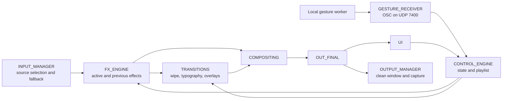

# Operator network

The app is built under `/project1/SNAP_REALITY`. The five-effect checkpoint contains the same core path with a smaller catalog and a DEMO-only source.

- `INPUT_MANAGER` supplies DEMO or a user-selected source at the working resolution.
- `CONTROL_ENGINE` owns transitions, modes, cooldown, event policy, playlist order, and reset. Its frame callback updates TOP state. The receiver parses OSC data without running tracker inference.
- `FX_ENGINE` uses GLSL TOPs and switches to request the active effect. The previous effect is requested during a transition. Frame Echo and Neon Trails use bounded feedback.
- `TRANSITIONS` mixes the two images and composites procedural overlays and generated typography. The compositor uses the active image directly while idle.
- `DIAGNOSTICS` contains build information. Runtime status is available through the performance controls.

The full effect catalog is declared in [effects.json](../presets/effects.json). Transition layer composition is declared in [transitions.json](../presets/transitions.json), and the [reference-inspired timeline](../presets/reference_inspired_timeline.json) schedules the DEMO showcase. See [DEVELOPMENT.md](../DEVELOPMENT.md) for observed validation.
