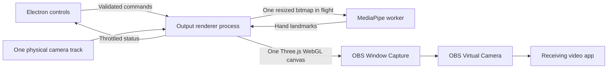

# Windows and browser architecture

- `Camera.ts` owns the media stream and reports new decoded frames through `requestVideoFrameCallback` where supported. `Engine.ts` schedules draws separately and retains its canvas, renderer, shader material and video texture across effect changes.
- `HandTracking.ts` only submits frames when the local MediaPipe worker is available. One transfer and inference may be in flight. There is no waiting-frame list. Late results are discarded. A temporal detector checks contact, palmward release and cooldown.
- `Engine.ts` compiles its shader asynchronously, draws a warm-up frame, then accepts effect selections. A bounded monitor tracks source cadence, render intervals, CPU submission time, GPU timer results when supported, hand inference and trigger-to-draw timing. The governor adjusts the chosen profile under sustained load and keeps the same camera and renderer.
- Electron's sandboxed output renderer owns the webcam, worker and WebGL context. Its sibling control window exchanges validated scalar commands and periodic metrics via preload IPC. Closing the controls leaves the output running. The browser switches the same canvas into Clean OBS output mode instead.
- The app draws a device-free procedural scene until the user starts the camera. The model is provisioned locally. There is no server-side inference, frame upload or OBS driver code.
